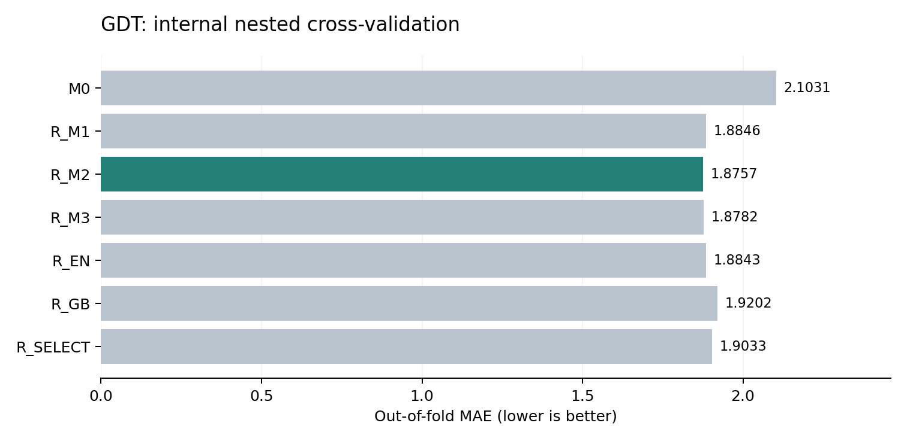
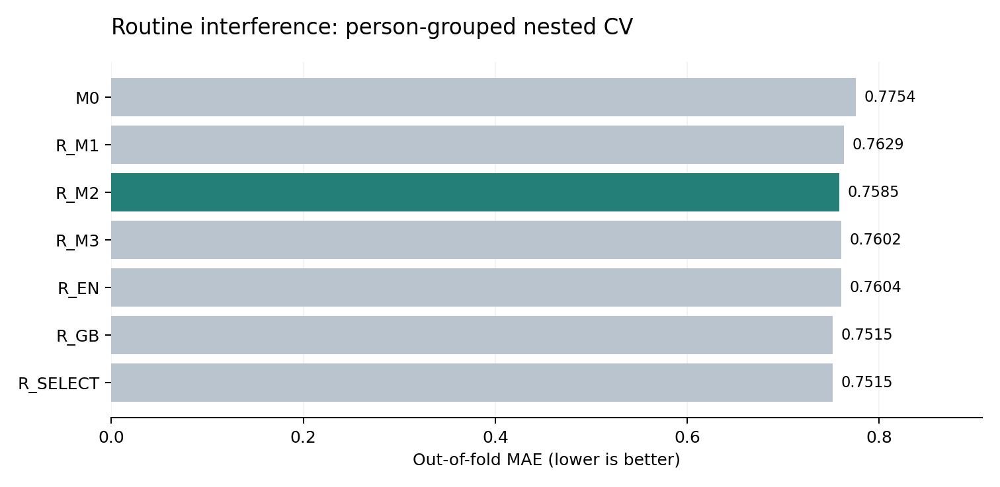
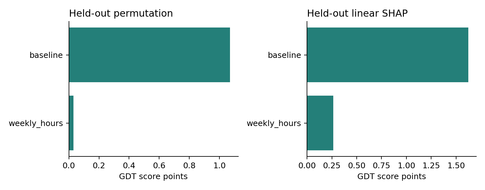

# Problematic Gaming Early Warning

## Final research report

Group 7 | SIC Capstone | 18 November 2026

Yunus Berkay İnci, Deniz Caman, Fatih Yılmaz, İsa Adahan Ünal, Alperen Acar

## Abstract

We completed a reproducible Steam-only added-value study using the pinned Open Play dataset. All 30 rounded metrics from the ten previously reported model rows were reproduced. A timing audit found that the cleaned Steam rows are collapsed approximate records rather than individual hourly buckets, and that eight records accepted by the earlier code extended beyond the prediction cutoff. We retained the earlier experiment as a reproduction and evaluated a corrected timing interpretation separately on the same 543 participants. The two-input Ridge model had MAE 1.8757, RMSE 2.3853 and R squared 0.4261. The tested daily patterns did not demonstrate added value. We also completed the next-survey routine-interference task with person-grouped validation on 2,093 transitions from 935 people. The delivery includes a synthetic Streamlit demonstration, a protected local API and executable validation. These internal results do not establish clinical utility or an independently validated early-warning system.

## 1 Research objectives

RQ1 asks whether the first 14 days of captured gameplay add predictive information beyond baseline GDT and total captured time for the later GDT measurement. RQ2 asks whether the previous 14 days of gameplay improve prediction of next-survey routine interference beyond its current value and total time. NLP was optional in the concept note.

Earlier Group 7 analyses provide the reproduction reference. We retain their documented cohort, feature definitions, model grids and split scheme, and compare the measured metrics and synthetic predictions. The corrected timing analysis is reported separately so that changes in preprocessing remain visible.

## 2 Data and timing

The only dataset is Open Play commit `eb0a68c1a7ca1fad54e57a1f89b9d5450f8be840` [1]. The downloader retrieves `survey_biweekly.csv.gz`, `survey_intake.csv.gz`, `steam.csv.gz`, the codebook, cleaning code and documentation from that commit. Their actual SHA-256 values are locked in `data/source_lock.json`; modified local files are refused. Personal-level files remain local and are excluded from the release.

The survey contains 6,844 records from 1,948 people. Intake contains 33,046 records. We require qualified=True, age 18-40, scheduled waves 1-6 and all four GDT items completed at waves 1 and 6. Never through Very often are mapped to 1-5; the total ranges from 4 to 20. Targets are not imputed. Of 730 complete pairs, 723 match intake and 710 meet eligibility. Of these, 543 have a retained early Steam record. The remaining 167 are not labeled nonplayers. GDT increased for 199 people, remained equal for 136 and decreased for 375.

RQ1 prediction time is baseline plus 14 days; the target is wave 6 GDT total. Subtracting baseline from both observed and predicted totals leaves MAE and RMSE unchanged, but not R squared. GDT asks about the previous three months [2], and recall windows overlap. We predict later measured symptom burden, not incident disorder or exclusively post-cutoff symptoms.

## 3 Quality audit and correction

Provider cleaning is not identical to the course analysis. The provider removes idle/non-game titles, limits original approximate records to 480 minutes, expands records into hours, scales combined hours above 60 minutes, then collapses the corrected pieces back to approximate records. It adjusts an approximate end from corrected total minutes (`data-process.qmd`, Steam preprocessing). Therefore `datetime_hour_start` is a starting-hour label; `minutes` can span multiple hours. This motivates a timing sensitivity analysis alongside the original starting-hour calculation.

| Audit item | Measured result |
| --- | --- |
| Duplicate survey person-wave / intake IDs | 0 / 0 |
| Survey people / rows without intake match | 108 / 173 |
| Off-schedule wave-7 rows | 11; excluded |
| Invalid survey dates / negative or nonfinite Steam minutes | 0 / 0 |
| Steam rows / people | 837,181 / 2,805 |
| Repeated person-title-start keys / duplicate complete selected records | 5 / 0 |
| Individual records exceeding 60 minutes | 141,868 |
| Starting-hour sums exceeding 60 minutes | 169,683 |
| Approximate allocated hours exceeding 60 minutes | 168,832 / 1,013,540 |
| Approximate interval overlap rows / people | 199,635 / 2,616 |
| UTC day totals exceeding 1,440 minutes | 0 |
| Maximum final elapsed study-day total | 1369.07 minutes |
| Legacy early records / corrected early records | 23,611 / 23,603 |
| Legacy records with end and source timestamp beyond cutoff | 8 |

Counts above 60 and approximate overlaps are diagnostics, not proof of concurrent active gaming or automatically invalid rows. The approximate allocated maximum is 134.37 minutes/hour. Reconstructing intervals from collapsed corrected totals cannot reproduce the provider's original hour-level scaling. The five repeated keys have distinct selected records; we retain them rather than silently deduplicating. No additional clipping is imposed. `results/quality_audit.json` also reports missing GDT totals by wave; intermediate waves are mostly structurally missing, so they are not imputed. Valid eligible baseline GDT exists for 1,598 people: completers average 8.44 at baseline versus 8.88 among the 888 without a complete final measure, indicating possible attrition bias.

The reproduction uses the submitted starting-hour rule exactly. The final timing analysis additionally requires each whole approximate interval, its original end, and its source timestamp to be within the input window; its labeled hour must also fit wholly inside. It then distributes retained corrected minutes proportionally across elapsed 24-hour study bins, conserving total minutes. Eight leaking records are removed, and all 543 participants remain in identical order. This is an exploratory sensitivity correction after earlier scores were known, not a preregistered analysis. Approximate intervals remain a timing model, not exact sessions; retrospective provider preprocessing and the original raw hourly allocation have not been prospectively validated.

Clean positive-play records do not establish an hourly observability denominator. The provider's article uses an additional raw account-linking file and fallback exposure assumptions. We did not interpret a positive-record fraction as 80% observation coverage, or infer actual nonplay from a zero recorded-day aggregate. Both tasks remain conditional Steam analyses.

## 4 Models and validation

Features are baseline score, recorded 14-day minutes / 120 (`weekly_hours`), active elapsed study days, sample SD of 14 daily minute totals, maximum daily minutes and second-week minus first-week hours. A day without a retained record has zero captured minutes, with no true-zero-play claim. M0 carries the current score forward; M1 learns from it; M2 adds captured hours; M3 adds the four daily-pattern features. All transformations are fitted within training folds [3]. IDs, target surveys and post-cutoff telemetry are excluded from predictors.

RQ1 uses five shuffled outer folds (seed 42), three shuffled inner folds (seed 43) and negative MAE for tuning. Original Ridge alphas are 0.1, 1, 10. Refinement uses Ridge alphas 0.001, 0.01, 0.1, 1, 10, 100, 1000 for M2/M3; Elastic Net alpha 0.001, 0.01, 0.1, 1, 10 crossed with l1_ratio 0.1, 0.5, 0.9, 1.0; and 100-tree gradient boosting with learning rate 0.03/0.05, depth 1/2, leaf size 20/40 and seed 42. Elastic Net uses max_iter=20000 and tol=1e-5. R SELECT chooses among these 42 settings within the inner loop. R M1 uses the same seven Ridge alphas for the final score-only comparison and does not expand R SELECT's candidate set.

Every comparison uses the same people and outer folds within its task. Each RQ1 person receives exactly one held-out prediction. RQ2 uses GroupKFold(5) outside and GroupKFold(3) inside; all transitions from each person stay together. Training error, inner tuning error, held-out evaluation and the full-data refit are separate quantities. The same primary cohort was already explored in previous coursework, so neither rerunning these folds nor creating a new random split would constitute an untouched independent test.

## 5 Reproduction and primary results

| Model | MAE | RMSE | R squared |
| --- | --- | --- | --- |
| M0 | 2.1031 | 2.8304 | 0.1920 |
| M1 | 1.8846 | 2.4057 | 0.4162 |
| M2 | 1.8757 | 2.3852 | 0.4262 |
| M3 | 1.8778 | 2.3893 | 0.4242 |
| M3_GB | 1.9168 | 2.4171 | 0.4107 |
| R_M2 | 1.8757 | 2.3852 | 0.4262 |
| R_M3 | 1.8778 | 2.3893 | 0.4242 |
| R_EN | 1.8837 | 2.3892 | 0.4242 |
| R_GB | 1.9158 | 2.4239 | 0.4074 |
| R_SELECT | 1.9026 | 2.4198 | 0.4094 |

All 30 rounded reference metrics match. The earlier M3-M2 MAE difference is +0.002109 with a conditional 95% interval [-0.015900, 0.020098], also matching the report. Full-data legacy family selection chooses two-input Ridge alpha=0.001. Its reconstructed saved-model prediction for baseline=8 and hours=12 is 7.3434673981, rounding to the reported 7.3435. The current model bundle has its own version and checksum; reproduction equivalence is assessed using measured metrics and predictions.

The following results use the corrected timing interpretation on the same 543 people:

| Model | MAE | RMSE | R squared |
| --- | --- | --- | --- |
| M0 | 2.1031 | 2.8304 | 0.1920 |
| R_M1 | 1.8846 | 2.4057 | 0.4162 |
| R_M2 | 1.8757 | 2.3853 | 0.4261 |
| R_M3 | 1.8782 | 2.3881 | 0.4248 |
| R_EN | 1.8843 | 2.3912 | 0.4233 |
| R_GB | 1.9202 | 2.4252 | 0.4068 |
| R_SELECT | 1.9033 | 2.4210 | 0.4088 |

R M3 minus R M2 MAE is +0.002466; the participant bootstrap 95% interval is [-0.015368, 0.020849]. It uses 2,000 resamples, seed 42, and fixed aligned OOF absolute errors. It does not refit models or capture all training, family-selection or previous-analysis uncertainty, and is not a confirmatory significance test. The conclusion remains that these daily patterns did not demonstrate useful added predictive value over captured amount and baseline GDT.

Full-cohort inner family selection chooses the two-input Ridge model with alpha=0.001 for research inference. Its family-specific nested-CV row and the entire R SELECT procedure are both shown: R SELECT MAE is 1.9033, not the selected family's 1.8757. Selecting the best outer row and calling that an unbiased final score would be inappropriate. The saved refit's training performance is not used as a test metric.

## 6 Secondary routine-interference analysis

The codebook labels the routine item from interference to support, and describes its previous-two-week recall [2]. The clean file ranges from -3 to +3, with negative indicating interference. We negate it so higher means more interference. It concerns sleep, hygiene and eating together and is not a validated disorder scale or a sleep-only measure.

Consecutive scheduled waves with both routine values yield 4,372 pairs from 1,206 eligible people. Requiring actual timestamp gaps of at least 14 days yields 2,775 pairs from 1,161 people, reproducing the earlier pretelemetry counts. Requiring retained strict Steam records in the 14 days before the current survey yields 2,093 transitions from 935 people. The smallest retained gap is 14.00001157 days. Current interference is known at prediction time; the target and its telemetry are excluded. Both inner and outer CV group by person.

| Model | MAE | RMSE | R squared |
| --- | --- | --- | --- |
| M0 | 0.7754 | 1.2058 | -0.0867 |
| R_M1 | 0.7629 | 1.0261 | 0.2130 |
| R_M2 | 0.7585 | 1.0252 | 0.2145 |
| R_M3 | 0.7602 | 1.0277 | 0.2106 |
| R_EN | 0.7604 | 1.0272 | 0.2113 |
| R_GB | 0.7515 | 1.0321 | 0.2039 |
| R_SELECT | 0.7515 | 1.0321 | 0.2039 |

Adding captured hours reduces Ridge MAE descriptively from 0.7629 to 0.7585. Adding daily-pattern features gives a paired MAE difference of +0.001741, with a person-cluster bootstrap 95% interval [-0.000493, 0.004001]. Each resampled person contributes all of their transitions; the point estimate weights transitions. Person-balanced MAE is separately recorded in `results/secondary.json`. R SELECT chooses gradient boosting in all five outer folds and obtains MAE 0.7515; this does not isolate the added value of patterns from algorithm choice. No secondary outcome is served to users and no external confirmation is claimed.

## 7 Explainability

We computed permutation importance on held-out outer-fold people with 20 repeats and seed 42. We also implemented exact interventional linear SHAP for the Ridge models: after each training-fitted imputer/scaler, the attribution is beta_j multiplied by (z_j minus its training mean). The background integrates missing features over empirical training marginals. This additive linear case needs no approximate SHAP library. Held-out additivity residuals were below 1e-8. Only aggregates are exported. This is interventional rather than conditional SHAP; correlated features are not modeled conditionally [4].

| Model | Feature | Permutation MAE increase | Mean absolute SHAP |
| --- | --- | --- | --- |
| R_M2 | baseline | 1.0708 | 1.6237 |
| R_M2 | weekly_hours | 0.0307 | 0.2649 |
| R_M3 | baseline | 1.0574 | 1.6031 |
| R_M3 | weekly_hours | 0.0581 | 0.3326 |
| R_M3 | active_days | 0.0056 | 0.1185 |
| R_M3 | sd_minutes | 0.0904 | 0.4318 |
| R_M3 | max_minutes | 0.0805 | 0.3982 |
| R_M3 | week_change | 0.0007 | 0.0407 |

Importance describes a fitted prediction rule. A feature can have sizeable attribution within M3 without improving M3 over M2. Correlated inputs can redistribute attributions; neither permutation nor SHAP establishes a causal effect or a treatment strategy.

| Feature | Training mean | Training SD | Scaled coefficient | Raw-unit coefficient |
| --- | --- | --- | --- | --- |
| baseline | 8.624309 | 3.290524 | 1.963506 | 0.596715 |
| weekly_hours | 15.037451 | 13.851895 | 0.345065 | 0.024911 |

Its standardized intercept is 7.791897. In original units, predicted total = 2.271042 + 0.596715 * baseline + 0.024911 * recorded weekly hours. A one-hour difference changes this model's prediction by about 0.0249 points holding baseline fixed; it is an observational coefficient, not an intervention effect. Means and population SDs describe the final training scaler, not a held-out test summary.

## 8 Research demonstration and software validation

Streamlit displays actual aggregate metrics and charts and computes three fictional scenarios using the saved model. It imports `deployment/inference.py` directly, the same implementation used by FastAPI; it does not call a running API. No participant selection, uploads, personal screening, clinical threshold or alerts exist. The new final synthetic A result is 7.3436958590, rounding to 7.3437; the small change from 7.3435 follows the timing correction and has a separate model version.

The API binds to loopback by the documented launch command and exposes /health, /predict and /metrics. All require X-API-Key from an environment credential of at least 24 characters; constant-time comparison is used. The request schema forbids extra fields and admits only three synthetic identifiers. Interactive documentation is disabled. The trusted locally trained Joblib is hash-checked before loading, with feature schema, commit and scikit-learn version checks. Joblib is pickle-based [5]; a manifest checksum is not authentication against an attacker who can replace both files.

Responses have no-store headers and request IDs. Monitoring records only request ID, status, duration and model version. Counters and the last-1,000-request latency window are in memory and reset on restart. This is a single-process local HTTP prototype; HTTPS, cloud hosting, uptime, rate limiting, rollout/rollback and multiuser production have not been validated.

Validation in a newly created Mac Python 3.12.14 virtual environment covered data checksum verification, cohort reconstruction, complete-window boundaries, actual survey gaps, person-separated splits, training-only transformations, SHAP additivity, altered-model refusal and save/load prediction equivalence. The 13 research/UI tests passed. API verification passed 25/25 checks, including real loopback HTTP, missing/wrong keys, strict schemas, all scenarios, metrics and model-not-ready status. A real browser inspection confirmed charts and scenario recalculation; synthetic A changed from 7.3437 to B at 9.7306. Windows and Linux execution were not tested; portable commands are provided. Software tests do not validate predictive performance.

## 9 Scope reconciliation and limitations

The reproducible primary experiment, secondary task, aggregate explanations and local demo are completed within a conditional Steam scope. Night-time share is omitted because the intake provides coarse GMT offsets and country rather than verified individual IANA timezone histories, and collapsed intervals do not preserve exact timing. Exact session measures are omitted because Steam times are approximate; Nintendo/Xbox would require separate ingestion and validation. Multi-platform coverage, game variety/genres, consecutive-day and weekend features remain future work. Random Forest was a secondary candidate rather than a required family; it was not added after observing the established results. Optional NLP remains future work because no independent human-label set or annotation reliability study was supplied. Raw texts were not sent to external services.

These decisions are mapped to every planned objective and feature group in `docs/RESEARCH_SCOPE.md`. We do not claim that the entire original multi-platform design has been implemented. Coverage cannot be validated from the selected files, outcomes are self-reported, attrition is nonrandom, and the voluntary US/UK adult sample does not establish generalization to children, clinical populations or Türkiye. No external test, prospective operation, diagnosis or prevention effect has been evaluated. The model has learned from participants and is not described as anonymous or risk-free.

## 10 Reproduction and delivery

Run `python -m analysis.download`, `python -m analysis.prepare`, `python -m analysis.train --mode all`, `python -m deployment.verify`, `python -m pytest -q`, and `python -m analysis.report` from an activated Python 3.12 environment installed from `requirements-lock.txt`. `README.md` gives explicit macOS/Linux and Windows commands, UI/API launch instructions and key generation. Tables and figures are generated from the measured JSON results. `tools/render_report.py` optionally renders this Markdown to PDF using `requirements-report.txt`.

The repository contains the analysis and serving source code, locked dependencies, a versioned linear model, aggregate results and this report. Participant-level surveys, gameplay records, feature tables, out-of-fold predictions, credentials and runtime logs are excluded. Data can be downloaded locally from the pinned source for reproduction; local data directories are ignored by version control. Dataset terms include a no-reidentification clause.

## References

[1] Digital Wellbeing. Open Play data and cleaning code, commit eb0a68c1a7ca1fad54e57a1f89b9d5450f8be840. https://github.com/digital-wellbeing/open-play/tree/eb0a68c1a7ca1fad54e57a1f89b9d5450f8be840

[2] Digital Wellbeing. Open Play codebook, Biweekly sheet: gdt_1-gdt_4 and gaming_value_routines; pinned commit above. https://github.com/digital-wellbeing/open-play/blob/eb0a68c1a7ca1fad54e57a1f89b9d5450f8be840/codebook.xlsx

[3] scikit-learn. Nested versus non-nested cross-validation. https://scikit-learn.org/stable/auto_examples/model_selection/plot_nested_cross_validation_iris.html . Executed estimator behavior is pinned to scikit-learn 1.8.0.

[4] Lundberg, S. M., and Lee, S.-I. (2017). A unified approach to interpreting model predictions. Advances in Neural Information Processing Systems 30. https://arxiv.org/abs/1705.07874 . The linear interventional special case is implemented and checked for additive reconstruction in the accompanying code.

[5] scikit-learn. Model persistence. https://scikit-learn.org/stable/model_persistence.html
